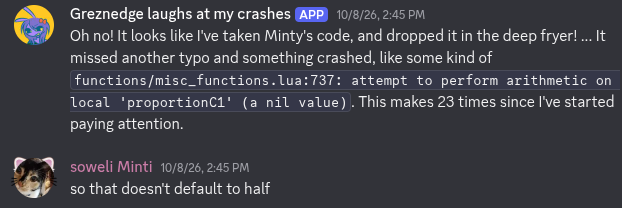

Interact with a Discord webhook when Balatro crashes. Comes with a deck to automatically crash, for testing.

Instructions TBA; until then, see the comments in [crash_webhooks.lua](crash_webhooks.lua). You'll need [DebugPlus](https://github.com/WilsontheWolf/DebugPlus) to execute these commands.

TODO:
- Instructions.
- Interface?
- Fix that thing with the file locations. It works it's just messy.